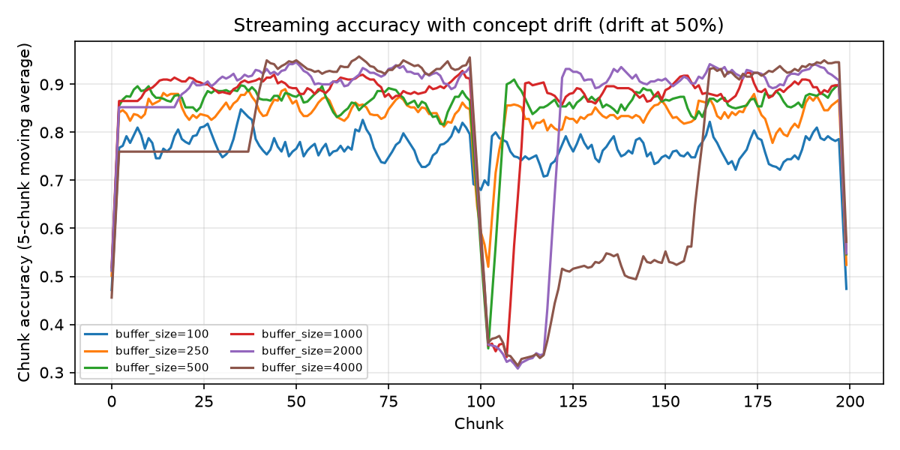

# NumCompute-Stream benchmark results

## Environment

- python: 3.14.8
- numpy: 2.5.5
- platform: Windows-10-10.0.19045-SP0
- machine: AMD64
- processor: Intel64 Family 6 Model 142 Stepping 9, GenuineIntel
- cpu_count: 4
- date: 2026-11-17 04:07 UTC
- seed: fixed per benchmark
- mode: full

## A. Loop-based vs vectorised

**Best-split search (one node, 6 features)**

| Size | Loop | Vectorised | Speed-up | Match |
|---:|---:|---:|---:|:---:|
| 200 | 64.86 ms | 876.7 us | 74.0x | yes |
| 500 | 154.09 ms | 1.13 ms | 136.5x | yes |
| 1,000 | 348.22 ms | 2.17 ms | 160.6x | yes |
| 2,000 | 990.52 ms | 2.96 ms | 334.4x | yes |

**Full tree fit (max_depth=6)**

| Size | Loop | Vectorised | Speed-up | Match |
|---:|---:|---:|---:|:---:|
| 200 | 353.45 ms | 17.16 ms | 20.6x | yes |
| 400 | 772.12 ms | 21.51 ms | 35.9x | yes |
| 800 | 1.277 s | 28.30 ms | 45.1x | yes |
| 1,600 | 2.955 s | 39.15 ms | 75.5x | yes |

**Tree prediction (per-sample walk vs level-wise)**

| Size | Loop | Vectorised | Speed-up | Match |
|---:|---:|---:|---:|:---:|
| 1,000 | 8.07 ms | 341.8 us | 23.6x | yes |
| 10,000 | 96.05 ms | 1.99 ms | 48.3x | yes |
| 50,000 | 437.91 ms | 16.55 ms | 26.5x | yes |

**Streaming confusion-matrix update**

| Size | Loop | Vectorised | Speed-up | Match |
|---:|---:|---:|---:|:---:|
| 1,000 | 558.2 us | 24.5 us | 22.8x | yes |
| 10,000 | 7.22 ms | 144.7 us | 49.9x | yes |
| 100,000 | 48.75 ms | 3.22 ms | 15.2x | yes |

## B. Effect of `buffer_size` (streaming, prequential evaluation)

Setup: 20,000 samples, chunks of 100, `max_depth=8`, mean over seeds [0, 1, 2]. Accuracy is cumulative test-then-train accuracy (chunks before the first retrain are not scored).

**Stationary stream**

| buffer_size | Accuracy (mean +/- sd) | Retrains | Mean retrain time | Total retrain time | Total fit time |
|---:|---:|---:|---:|---:|---:|
| 100 | 0.782 +/- 0.001 | 200 | 9.81 ms | 1.962 s | 1.967 s |
| 250 | 0.850 +/- 0.005 | 66 | 20.46 ms | 1.351 s | 1.354 s |
| 500 | 0.872 +/- 0.003 | 40 | 29.49 ms | 1.180 s | 1.183 s |
| 1,000 | 0.895 +/- 0.006 | 20 | 48.01 ms | 0.960 s | 0.963 s |
| 2,000 | 0.919 +/- 0.004 | 10 | 76.92 ms | 0.769 s | 0.772 s |
| 4,000 | 0.934 +/- 0.001 | 5 | 116.01 ms | 0.580 s | 0.583 s |

**Stream with concept drift at 50%**

| buffer_size | Accuracy (mean +/- sd) | Retrains | Mean retrain time | Total retrain time | Total fit time |
|---:|---:|---:|---:|---:|---:|
| 100 | 0.767 +/- 0.001 | 200 | 9.23 ms | 1.845 s | 1.849 s |
| 250 | 0.835 +/- 0.005 | 66 | 20.82 ms | 1.374 s | 1.377 s |
| 500 | 0.852 +/- 0.003 | 40 | 29.05 ms | 1.162 s | 1.165 s |
| 1,000 | 0.865 +/- 0.004 | 20 | 59.23 ms | 1.185 s | 1.188 s |
| 2,000 | 0.854 +/- 0.002 | 10 | 102.57 ms | 1.026 s | 1.029 s |
| 4,000 | 0.766 +/- 0.006 | 5 | 123.79 ms | 0.619 s | 0.622 s |

