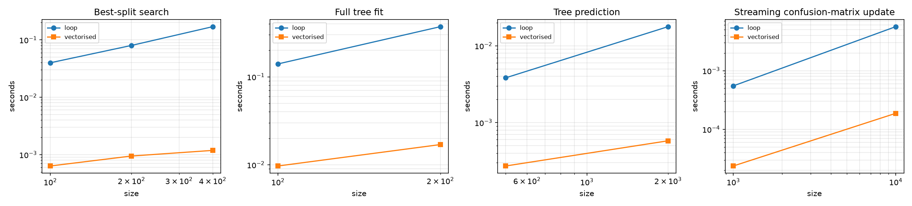
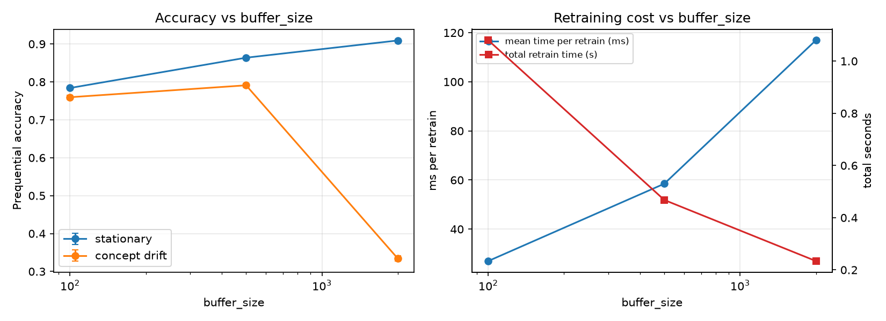

# NumCompute-Stream benchmark results

## Environment

- python: 3.14.8
- numpy: 2.5.5
- platform: Windows-10-10.0.19045-SP0
- machine: AMD64
- processor: Intel64 Family 6 Model 142 Stepping 9, GenuineIntel
- cpu_count: 4
- date: 2026-11-17 04:00 UTC
- seed: fixed per benchmark
- mode: quick

## A. Loop-based vs vectorised

**Best-split search (one node, 6 features)**

| Size | Loop | Vectorised | Speed-up | Match |
|---:|---:|---:|---:|:---:|
| 100 | 39.86 ms | 634.2 us | 62.9x | yes |
| 200 | 79.96 ms | 946.3 us | 84.5x | yes |
| 400 | 169.82 ms | 1.19 ms | 143.2x | yes |

**Full tree fit (max_depth=6)**

| Size | Loop | Vectorised | Speed-up | Match |
|---:|---:|---:|---:|:---:|
| 100 | 140.17 ms | 9.69 ms | 14.5x | yes |
| 200 | 371.92 ms | 16.98 ms | 21.9x | yes |

**Tree prediction (per-sample walk vs level-wise)**

| Size | Loop | Vectorised | Speed-up | Match |
|---:|---:|---:|---:|:---:|
| 500 | 3.82 ms | 272.0 us | 14.1x | yes |
| 2,000 | 17.73 ms | 578.9 us | 30.6x | yes |

**Streaming confusion-matrix update**

| Size | Loop | Vectorised | Speed-up | Match |
|---:|---:|---:|---:|:---:|
| 1,000 | 550.2 us | 23.7 us | 23.2x | yes |
| 10,000 | 5.63 ms | 187.4 us | 30.0x | yes |

## B. Effect of `buffer_size` (streaming, prequential evaluation)

Setup: 4,000 samples, chunks of 100, `max_depth=6`, mean over seeds [0, 1]. Accuracy is cumulative test-then-train accuracy (chunks before the first retrain are not scored).

**Stationary stream**

| buffer_size | Accuracy (mean +/- sd) | Retrains | Mean retrain time | Total retrain time | Total fit time |
|---:|---:|---:|---:|---:|---:|
| 100 | 0.784 +/- 0.000 | 40 | 27.00 ms | 1.080 s | 1.083 s |
| 500 | 0.864 +/- 0.000 | 8 | 58.49 ms | 0.468 s | 0.469 s |
| 2,000 | 0.909 +/- 0.001 | 2 | 116.93 ms | 0.234 s | 0.235 s |

**Stream with concept drift at 50%**

| buffer_size | Accuracy (mean +/- sd) | Retrains | Mean retrain time | Total retrain time | Total fit time |
|---:|---:|---:|---:|---:|---:|
| 100 | 0.760 +/- 0.006 | 40 | 16.54 ms | 0.662 s | 0.663 s |
| 500 | 0.791 +/- 0.006 | 8 | 26.36 ms | 0.211 s | 0.212 s |
| 2,000 | 0.334 +/- 0.007 | 2 | 51.25 ms | 0.103 s | 0.103 s |

